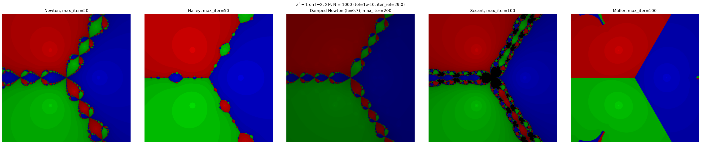
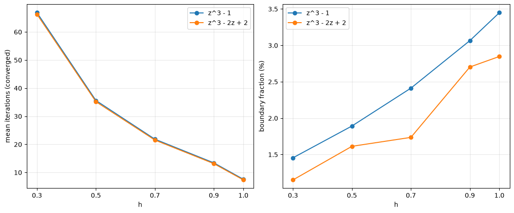
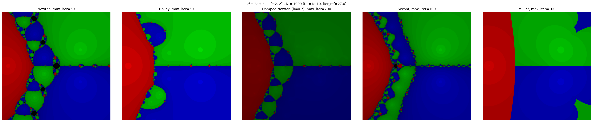

# Newton fractals and root-finding methods

This project computes and compares the **basins of attraction** of several root-finding methods
(Newton, Halley, damped Newton, secant and Müller) on polynomials in the complex plane.
For every point of a grid the method is iterated, the outcome is classified (converged to a root,
not converged, or numerical failure), and the cost and the shape of the basins are measured.

**Guiding question:** Which root-finding method is more reliable depending on the starting point, and why?

To answer it, we compare the effect of the method, the polynomial, the damping and the floating-point precision.

## Methods

- **Newton:** `z - f(z)/f'(z)`.
- **Halley:** `z - 2 f f' / (2 f'^2 - f f'')`.
- **Damped Newton:** `z - h f(z)/f'(z)` with `h = 0.7` (except in E6, which varies `h`).
- **Secant:** uses `(z_{k-1}, z_k)`, with the convention `z_{-1} = z_0 + δ`.
- **Müller:** fits a parabola through `(z_{k-2}, z_{k-1}, z_k)` and picks the sign of the square root
  that gives the denominator of larger modulus; initial state `(z_0, z_0 + δ, z_0 + 2δ)`.

## Experiments

| Experiment | What it does | Script |
|---|---|---|
| E0 | Basin map of Newton on z³−1 and comparison of the five methods | `experiments/e0_newton_z3.py`, `experiments/e0_compare.py` |
| E1 | % of each basin by grid size N and window (square or disk) | `experiments/e1_basins.py` |
| E2 | Cost: iterations and evaluations of f/f'/f'' until convergence, with histograms | `experiments/e2_cost.py` |
| E3 | Failures and non-convergence on z³−2z+2 (Newton's 0 → 1 → 0 cycle) | `experiments/e3_failures.py` |
| E3b | Diagnosis of the secant method on z³−1: non-converged points by `max_iter`, their final state, and a sweep of δ ∈ {1e-2, 1e-3, 1e-4, 1e-6} with `max_iter` = 200 (generates `figures/diag_secant.png`) | `experiments/e3b_secant_diag.py` |
| E4 | Order of convergence with mpmath at 300 digits, including the double root | `experiments/e4_order.py` |
| E5 | Comparison on z³−1, z⁴−1, z⁵−1, z⁶−1, (z−1)²(z+1) and z³−2z+2 | `experiments/e5_polynomials.py` |
| E5b | Checks on E5: Newton on z⁵−1 with `max_iter` = 40 and 50, and where the secant method fails (inside and outside \|z₀\| < 1) | `experiments/e5b_checks.py` |
| E6 | Damped Newton as a function of `h` and boundary complexity | `experiments/e6_damped.py` |
| E7 | Effect of precision: complex64 versus complex128 (Müller with δ = 1e-2, secant with δ = 1e-3) | `experiments/e7_precision.py` |
| E7b | Müller in E7: effect of δ (sweep over 1e-1, 1e-2 and 1e-3) and distance of the differing pixels to the boundaries (generates `results/e7b_muller_delta.csv` and `figures/e7_diff_muller.png`) | `experiments/e7b_muller_delta.py` |

## Installation and usage

Requires Python 3.9 or later. From the repository root:

```bash
python -m venv .venv
source .venv/bin/activate        # on Windows: .venv\Scripts\activate
pip install -e .
```

Tests:

```bash
python -m pytest
```

Experiments (each one writes to `results/` and `figures/`; E3 and E5 take several minutes):

```bash
python experiments/e0_newton_z3.py
python experiments/e0_compare.py
python experiments/e1_basins.py
python experiments/e2_cost.py
python experiments/e3_failures.py
python experiments/e3b_secant_diag.py
python experiments/e4_order.py
python experiments/e5_polynomials.py
python experiments/e5b_checks.py
python experiments/e6_damped.py
python experiments/e7_precision.py
python experiments/e7b_muller_delta.py
```

> **Note:** `results/` and `figures/` are already in the repository, so there is no need to re-run
> the experiments to see the results.

## Folder structure

```
src/nfractals/
    methods.py        Newton, Halley, secant and Müller steps (NumPy, vectorised)
    runner.py         run_basins: iterates the grid with per-method state and classifies the points
    polynomials.py    polynomials, derivatives, reference roots (unique_roots, unity_poly)
    plotting.py       basin maps (hue = root, brightness = iterations)
    convergence.py    scalar mpmath versions to measure orders of convergence
experiments/          one script per experiment (E0 to E7) and the diagnostic ones (E3b, E5b, E7b)
tests/                validation tests (pytest)
results/              CSV tables of the experiments
figures/              generated figures
```

## Results on z³−1

Window [−2, 2]², N = 1000, tol = 1e-10 (complex128), δ = 1e-3 for the secant method and Müller. The data come from `results/e2_cost.csv`
(iterations and evaluations), `results/e5_polynomials.csv` (% of convergence) and
`results/e4_order.csv` (observed order: mean of the last three `p_k` of the 300-digit series).

| Method | max_iter | Mean iterations | Mean evaluations | % converged | Observed order |
|---|---|---|---|---|---|
| Newton | 50 | 7.586 | 15.172 | 100.00 | 2.000 |
| Halley | 50 | 4.390 | 13.169 | 100.00 | 2.996 (tends to 3) |
| Damped Newton (h = 0.7) | 200 | 21.841 | 43.683 | 100.00 | 1 (ratio 0.3) |
| Secant | 100 | 10.253 | 12.253 | 94.74 | 1.617 |
| Müller | 100 | 5.613 | 8.613 | 100.00 | 1.845 |

Mean iterations and evaluations are those of the converged points.



*Basins of z³−1 on [−2, 2]², from left to right: Newton, Halley, damped Newton, secant and
Müller. Each root has its own colour (red, green, blue) and the brightness drops as the iterations
increase; black marks the points that do not converge. The boundaries of Newton and damped Newton are
fractal, with islands of another colour. Halley's are smoother with fewer islands. The secant method
shows wide fractal bands along the boundaries, with black zones (not converged), mostly near the
centre. Müller's boundaries appear almost straight, with three sectors, and only small details appear
at the edges of the window.*



*Damped Newton on z³−1 and z³−2z+2 (values from `results/e6_damped.csv`). On the left, the mean
iterations of the converged points drop from 66.864 (z³−1) and 66.286 (z³−2z+2) with h = 0.3 to
7.586 and 7.353 with h = 1. On the right, the fraction of boundary pixels grows with h: from 1.4552 %
to 3.4496 % on z³−1 and from 1.1514 % to 2.8478 % on z³−2z+2, always below z³−1.*



*Basins of z³−2z+2 on [−2, 2]² with the same five methods and order as the first figure.
The real root (−1.769) takes the left zone in red and the two complex roots the rest, in green and
blue. Newton has black discs of points that do not converge: the largest is around z = 0, on the real
axis, and there are smaller ones scattered off the axis (points that Newton sends to the zone trapped
by the 0 ↔ 1 cycle). Halley and damped Newton have no black points. The secant method only shows a
small black spot next to the real axis. Müller's boundaries appear smoother and rounder.*

## Main findings

1. **Cost in evaluations (E2, z³−1):** Müller (8.613) < secant (12.253) < Halley (13.169) < Newton (15.172) ≪ damped Newton with h = 0.7 (43.683).
2. **Newton's 0 ↔ 1 cycle (E3, z³−2z+2):** Newton leaves 1.06 % of the grid unconverged; Halley, damped Newton and Müller converge at every point and the secant method fails at 0.09 %.
3. **Polynomial degree (E5):** the secant method degrades with the degree (94.74 % converged on z³−1, 79.64 % on z⁴−1, 77.46 % on z⁵−1 and 74.05 % on z⁶−1), while Müller stays above 99.6 % (minimum 99.65 % on z⁶−1).
4. **Observed orders (E4, 300 digits):** Newton 2.000, Halley 2.996 (tends to 3), secant 1.617, Müller 1.845; damped Newton and Newton at the double root are linear, with ratios 0.3 and 0.5 respectively.
5. **Damping (E6, z³−2z+2):** with h = 0.9 the cycle disappears (0 % unconverged versus 1.06 % with h = 1) at about 1.8 times more iterations (13.143 versus 7.353).
6. **Precision (E7, E7b):** complex64 versus complex128 changes the root almost only in pixels next to the boundaries (0.0026 % of the pixels for Newton, 0 % for Halley, 0.0010 % for damped Newton, 0.155 % for the secant method with δ = 1e-3 and 0.0548 % for Müller with δ = 1e-2). With δ = 1e-3, Müller instead differs in 6.71 % of the pixels, most of them far from the boundaries (E7b).

## Conventions and parameters

- **Window and grid:** [−2, 2]² with N × N points (N = 1000, except in E1, which uses 250, 500, 1000 and 2000).
- **Stopping criterion:** a point converges when its distance to the nearest root is below `tol` at the
  current iteration, `min_r |z − r| < tol`. The roots `r` are the distinct roots of `np.roots`, merging almost
  identical roots (double roots) with `unique_roots`, and the root assigned to a converged point is that
  nearest root. If the new value is not finite (inf or NaN) the point is marked as **failed**; if `max_iter`
  is exhausted, as **not converged**. This replaces the earlier criterion `|f(z)| < tol`: on z³−1 and
  z³−2z+2 the basins are identical pixel by pixel and only the iteration counts change (slightly fewer).
  At the double root of (z−1)²(z+1) the attainable accuracy of z is of the order of √ε ≈ 1.5e-8 (the
  rounding noise of f near a double root), so a tolerance of 1e-8 sits at the numerical floor: with it,
  0.1057 % of the points of Newton were not classified as converged and the secant method and Müller had
  0.0336 % and 0.0772 % of failed points. For that reason E5 uses `tol = 1e-6` for this polynomial, safely
  above the floor.
- **Tolerances:** `1e-10` in complex128; `1e-5` in complex64 (E7, about 84 times the machine epsilon
  of 1.2e-7); `1e-6` for the double-root polynomial (E5). E4 works with mpmath at 300 digits
  and stops when the error drops below `1e-250`.
- **`max_iter`:** 50 for Newton and Halley, 200 for damped Newton (300 in E6), 100 for the secant
  and Müller.
- **δ of the secant method and Müller:** `δ = 1e-3` everywhere, except in E7, where Müller uses `δ = 1e-2`
  in both complex64 and complex128 (the secant method stays at 1e-3). E7b keeps its sweep over 1e-1, 1e-2
  and 1e-3 as the diagnostic: with δ = 1e-3, Müller in complex64 differs from complex128 in 6.7 % of the
  pixels because δ is too small for that precision (the rounding error of the second divided difference is
  of order ε/δ²); with δ = 1e-2 the difference drops to 0.055 %.
- **Cost per step and initial evaluations:**
  Newton 2 evaluations per step (f, f'), Halley 3 (f, f', f''), damped Newton 2,
  secant 1 plus 2 initial, Müller 1 plus 3 initial. Evaluations per point =
  iterations × cost per step + initial evaluations.

## Team and course

- Pablo Arístegui
- Alfonso Botín-Sanz de Sautuola
- Álvaro Fernández-Canteli

Course: Numerical Methods, IE University, academic year 2026-27.
